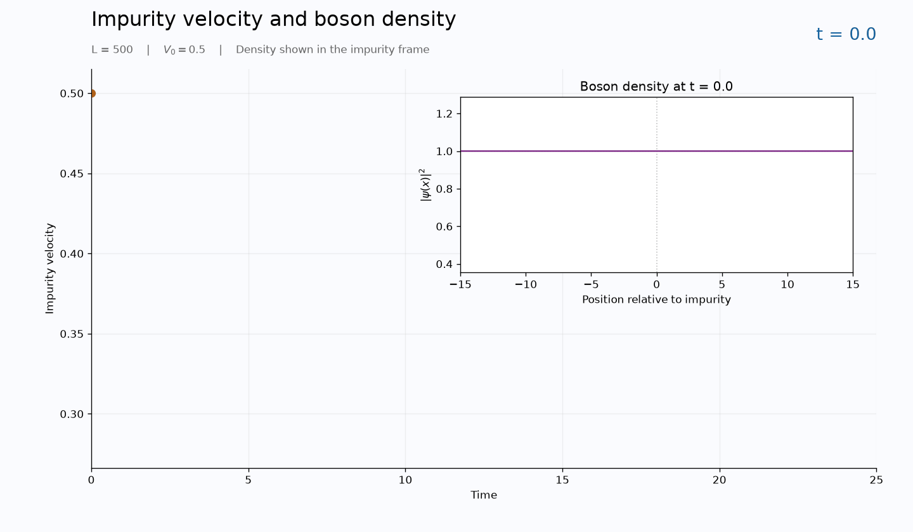

# Finite difference solver for a 1D Bose polaron

C++ solver for the coupled Gross–Pitaevskii equation and impurity velocity in
Eqs. (5) and (6) of [Majumdar and Petković, arXiv:2507.10402v2](https://arxiv.org/abs/2507.10402v2).
The method uses periodic boundaries, a cyclic Thomas solver, and Picard iteration
for the nonlinear update, with a velocity-dependent one-sided spatial stencil.

The command-line program supports both a uniform initial field, `phi(x)=1`, and
continuation from a saved field. The two supplied research programs remain
unchanged in the repository root. `src/numerics.hpp` preserves their shared
numerical routines (copied from the fresh-run program); `src/main.cpp` retains
the fresh-run update equations with a new input/output driver.

**Numerical status:** the packaged update matches the supplied fresh-run code
exactly in a small regression case. This does not establish exact particle-number
conservation: the short interacting example exhibits relative drift of about
`5.5e-5`. Check conservation and convergence for each scientific run. See
[VALIDATION.md](VALIDATION.md).

## Simulation example

Impurity velocity with a synchronized boson-density inset over $-15<x<15$
in the impurity frame. The animation uses all 51 saved configurations from
$t=0$ to $25$, with periodic system length $L=500$, $V_0=0.5$,
$m/M=0.333$, $`\widetilde{G}=1`$, and $\gamma=0.1$.
The simulation uses $\Delta x=0.001$, $\Delta t=0.01$, Picard tolerance
$10^{-8}$, and at most 10 iterations per step. Playback is accelerated.



[Download the MP4 video](docs/media/velocity_density_animation.mp4).

## Releases

Versioned source downloads are published on the [GitHub Releases page](https://github.com/saptarshi7889/Conservative-Finite-Difference-Method-for-GPE-of-1d-Bose-Polaron/releases).
See [RELEASE_NOTES.md](RELEASE_NOTES.md) for v0.1.0 requirements and numerical
limitations. Eigen is an external dependency; precompiled binaries are not included.

## Build

Requirements: a C++17 compiler, Eigen 3.3 or newer, and either Make or CMake 3.16+.
Python 3 is needed only for tests. No Python packages are required. Dependencies
must already be installed; neither local build command downloads anything.

```sh
make EIGEN_INCLUDE=/path/to/directory/containing/Eigen
make test
./build/gpe --help
```

On systems with Eigen under `/usr/include/eigen3`, plain `make` is sufficient.
An Eigen include directory contains `Eigen/Core`, rather than being the `Eigen`
directory itself. Paths containing spaces are supported when quoted.

Alternatively, with an installed Eigen CMake package:

```sh
cmake -S . -B build -DCMAKE_BUILD_TYPE=Release
cmake --build build --parallel 2
ctest --test-dir build --output-on-failure
cmake --install build --prefix "$HOME/.local"
```

For a nonstandard Eigen installation, pass `-DEigen3_DIR=/path/to/share/eigen3/cmake`.
Make also supports `make install PREFIX="$HOME/.local"`.
Do not mix the Make and CMake build directories; remove your generated build
directory or choose another CMake directory when switching build systems.

## Fresh run

```sh
./build/gpe --output results
```

The small default example uses length 16, spacing 0.125, time step 0.001, and
20 time steps. It is a functionality check, not a converged research simulation.
The original defaults use 20 million spatial points and many large complex
vectors, requiring several GB of memory; they are deliberately not the CLI defaults.

| Option | Default | Meaning |
| --- | --- | --- |
| `--length` | 16 | Periodic system length |
| `--dx` | 0.125 | Spatial spacing |
| `--dt` | 0.001 | Time step |
| `--end` | 0.02 | Final time, reached exactly |
| `--mass-ratio` | 0.125 | Boson/impurity mass ratio, m/M |
| `--coupling` | -1.5 | Dimensionless impurity coupling |
| `--gamma` | 0.1 | Positive boson interaction parameter |
| `--velocity` | 2 | Original injection velocity V0; retain this for restarts |
| `--tolerance` | 1e-8 | Absolute Euclidean norm tolerance between Picard iterates |
| `--iterations` | 12 | Maximum Picard iterations per time step |
| `--save-every` | 10 | Steps between norm diagnostics and field snapshots |
| `--velocity-every` | save-every | Steps between velocity records (flushed immediately) |
| `--output` | results | New output directory; must not already exist |

Options use `--name value`. Length/dx and (end-start)/dt must be integers within
floating-point tolerance. At least three spatial points are required. The CLI
stops with a nonzero exit code on nonconvergence or invalid input; it does not
silently accept a nonconverged iterate. Partial output remains available after a
failed run. The simulation runs a fixed number of steps; the legacy equilibrium
and cluster CPU-time stop conditions are not part of the CLI.

## Continue a run

For the default example, `results/phi_10.dat` is the field at time 0.01.
Read the corresponding real velocity from `results/velocity.dat`:

```sh
awk '$1 == 0.01 { print $2 }' results/velocity.dat
```

Substitute that value for `V_AT_CHECKPOINT` below:

```sh
./build/gpe --restart results/phi_10.dat --start 0.01 \
  --restart-velocity V_AT_CHECKPOINT --end 0.02 --output continued
```

Retain the original physical parameters, grid, time step, injection velocity,
and iteration settings. `--velocity` is always V0, whereas
`--restart-velocity` is the instantaneous velocity at the saved time. The velocity
update depends on both adjacent fields, so the checkpoint velocity must be
provided separately. The checkpoint grid and row count are checked, but the
three-column field file contains no physical-parameter metadata: matching those
parameters and the checkpoint time is the user's responsibility.

Legacy three-column snapshots are accepted when the grid matches. Legacy files
use lower output precision, so restarting from them can introduce rounding error.
The new output uses round-trip double precision. Snapshot step numbers restart
at zero in each output directory.

## Output

| File | Columns / content |
| --- | --- |
| `velocity.dat` | time, Re(V), Im(V) |
| `norm.dat` | time, Euclidean norm of phi, dx × sum(abs(phi)^2) |
| `convergence.dat` | time, accepted iteration count, norm of last iterate difference |
| `phi_STEP.dat` | x, Re(phi), Im(phi), without a header |
| `parameters.txt` | Physical and numerical parameters and restart provenance |

Diagnostics have comment headers starting with `#`. Initial and final states
are always saved. Configurations are published by atomic rename only after the
complete file is closed; diagnostics are flushed at each configuration save. The original norm output is `sqrt(sum(abs(phi)^2))`; the third
column of the new norm file gives the dimensionless particle-number integral.

The grid is `x_i = i*dx - length/2`. The supplied delta-potential routine places
its nonzero element at index `N/2-1`, which is `x=-dx` for an even grid. This
one-cell offset is retained for regression compatibility.

## Equation and units

The coefficient structure implements the dimensionless equations

```math
i\partial_t\phi = \left[-\frac{1+m/M}{2}\partial_x^2
 + |\phi|^2 + \widetilde G\delta(x) + i V(t)\partial_x\right]\phi,
```

```math
V(t)=V_0+\frac{i(m/M)}{\sqrt\gamma}\int\phi^*\partial_x\phi\,dx.
```

Here $x$ is measured in healing lengths, $t$ in inverse chemical-potential units,
$\phi$ in square roots of the background density, and $V$ in sound-speed units.
These conventions correspond to the coefficients of the supplied code.
The kinetic factor $1+m/M$ selects Eq. (5), rather than the alternative Eq. (7)
discussed in the paper. The discrete velocity routine uses symmetrization over both adjacent time slices,
as detailed below.


## Numerical algorithm

This section summarizes *GPE_simulation.pdf*, Chapter 1, printed pages 2–4,
Eqs. (1.3)–(1.7), before Section 1.1, and compares those notes with
[`src/main.cpp`](src/main.cpp) and [`src/numerics.hpp`](src/numerics.hpp).
The PDF is not bundled with this repository. Its Eqs. (1.6)/(1.7) describe the
updates referenced as Eqs. (4.6)/(4.7) in the inherited source comments.
Tildes on dimensionless quantities are omitted here; write $\mu=m/M$,
$h=\Delta x$, $\tau=\Delta t$, and $N=L/h$.

### Spatial and temporal discretization

The field is stored on $N$ periodic points, with indices interpreted modulo $N$.
Define the unscaled second difference and the velocity-selected first difference:

```math
(L_1\Phi)_j=\Phi_{j+1}-2\Phi_j+\Phi_{j-1},\qquad
(L_2(V)\Phi)_j=
\begin{cases}
\Phi_{j+1}-\Phi_j,&\mathrm{Re}(V)\geq0,\\
\Phi_j-\Phi_{j-1},&\mathrm{Re}(V)<0.
\end{cases}
```

For the ordered field vector $\Phi=(\Phi_0,\Phi_1,\ldots,\Phi_{N-1})^{\mathsf T}$,
the corresponding matrices are

```math
L_1=
\begin{pmatrix}
-2 & 1 & 0 & \cdots & 1 \\
1 & -2 & 1 & \ddots & 0 \\
0 & 1 & \ddots & \ddots & \vdots \\
\vdots & \ddots & \ddots & -2 & 1 \\
1 & 0 & \cdots & 1 & -2
\end{pmatrix}_{N\times N}.
```

For $\mathrm{Re}(V)\geq0$, the forward-difference matrix is

```math
L_2^{+}=
\begin{pmatrix}
-1 & 1 & 0 & \cdots & 0 \\
0 & -1 & 1 & \ddots & \vdots \\
\vdots & \ddots & \ddots & \ddots & 0 \\
0 & \cdots & 0 & -1 & 1 \\
1 & 0 & \cdots & 0 & -1
\end{pmatrix}_{N\times N}.
```

For $\mathrm{Re}(V)<0$, the backward-difference matrix is

```math
L_2^{-}=
\begin{pmatrix}
1 & 0 & \cdots & 0 & -1 \\
-1 & 1 & 0 & \ddots & 0 \\
0 & -1 & \ddots & \ddots & \vdots \\
\vdots & \ddots & \ddots & 1 & 0 \\
0 & \cdots & 0 & -1 & 1
\end{pmatrix}_{N\times N},\qquad
L_2(V)=
\begin{cases}
L_2^{+},&\mathrm{Re}(V)\geq0,\\
L_2^{-},&\mathrm{Re}(V)<0.
\end{cases}
```

The corner entries implement periodic boundaries. These are the unscaled
matrices shown in the notes: the derivative operators are $L_1/h^2$ and
$L_2(V)/h$. Their dimension is $N\times N$, where $N=L/h$ is the number of
grid points, rather than the physical system length $L$.

The forward stencil for positive velocity follows the sign of the drift in
$\partial_t\phi=V\partial_x\phi+\cdots$, whose transport speed is $-V$.
The delta potential is represented by $D_j=(\widetilde G/h)\delta_{j,j_*}$,
where $j_*=\lfloor N/2\rfloor-1$ is the inherited implementation location
(see the grid-offset note above).

The kinetic and drift terms are averaged between the old and new time slices.
The nonlinear term uses the average of the two densities multiplied by the
average field. With $W=V^n$ held fixed during the step, the implicit update is

```math
i\frac{\Phi^{n+1}-\Phi^n}{\tau}
=-\frac{1+\mu}{4h^2}L_1(\Phi^{n+1}+\Phi^n)
+\frac{iW}{2h}L_2(W)(\Phi^{n+1}+\Phi^n)
+\frac12\left[D+\frac{|\Phi^{n+1}|^2+|\Phi^n|^2}{2}\right]
\odot(\Phi^{n+1}+\Phi^n).
```

Here $\odot$ and the density operations act componentwise. This is a nonlinear
implicit scheme; the one-sided spatial drift stencil is first order in $h$.

### Picard iteration and cyclic solve

For each time step, set $\Psi_0=\Phi^n$ and form

```math
 a=\frac{i\tau(1+\mu)}{4h^2},\qquad b=\frac{\tau W}{2h},\qquad
 A_1=I-aL_1-bL_2(W),\qquad A_2=I+aL_1+bL_2(W).
```

Each Picard iteration solves the linear system

```math
A_1\Psi_{k+1}=A_2\Phi^n
-\frac{i\tau}{2}\left[D+\frac{|\Psi_k|^2+|\Phi^n|^2}{2}\right]
\odot(\Psi_k+\Phi^n).
```

`Temp` stores $A_2\Phi^n$; `Phi_k`, `Phi_tilde`, and `Phi_hat` store
$\Psi_k$, the right-hand side, and $\Psi_{k+1}$, respectively. Only vectors
and scalar stencil coefficients are stored, rather than dense matrices.
Periodicity makes $A_1$ cyclic tridiagonal. `Thomas_tridiagonal_solver_PBC`
uses two ordinary Thomas solves and a rank-one correction, giving $O(N)$
work and storage per Picard iteration.

Accept $\Phi^{n+1}=\Psi_{k+1}$ when
$\|\Psi_{k+1}-\Psi_k\|_2\leq\varepsilon$. This is an absolute, unweighted
Euclidean norm, not a relative error or an equation-residual test. The notes
specify $\varepsilon=10^{-9}$; the packaged CLI defaults to `--tolerance 1e-8`
and at most `--iterations 12` iterations. It stops with an error if convergence
is not reached within that limit.

### Coupled velocity update

After accepting the field, define $S_j=\Phi_j^n+\Phi_j^{n+1}$. The routine
`Velocity_calculation` evaluates the notes' symmetrized expression as

```math
V^{n+1}=V_0+\frac{i\mu}{8\sqrt\gamma}
\sum_{j=0}^{N-1}\left[
S_j^*(S_{j+1}-S_j)-S_j(S_{j+1}^*-S_j^*)\right].
```

The factors of $h$ from the spatial integral and first difference cancel.
The initial fresh-run field is $\Phi_j^0=1$, with $V^0=V_0$. The updated
velocity selects the stencil and coefficients for the **next** time step;
it is not iterated together with the field inside the current Picard loop.

### Conservation and scope

The notes base the nondrift discretization on the conservative finite-difference
scheme of V. A. Trofimov and N. V. Peskov, “Comparison of finite-difference schemes
for the Gross-Pitaevskii equation,” *Mathematical Modelling and Analysis*
**14**(1), 109–126 (2009), their reference [1]. They describe norm conservation
without drift and negligible norm decay with drift. These statements do not
establish exact conservation for the implemented one-sided drift scheme or a
finite Picard tolerance. Monitor $h\sum_j|\Phi_j|^2$ and check spatial, temporal,
and iteration convergence for the parameters of interest. The measured drift
and limits of the existing checks are documented in [VALIDATION.md](VALIDATION.md).

## License and citation

MIT license; see [LICENSE](LICENSE). Eigen is an external dependency and is not
vendored. Citation metadata is in [CITATION.cff](CITATION.cff).

Saptarshi Majumdar and Aleksandra Petković, “Relaxation dynamics of a mobile
impurity injected into a one-dimensional Bose gas,” Physical Review A **112**,
053326 (2025), [doi:10.1103/tgl5-rdn5](https://doi.org/10.1103/tgl5-rdn5).
