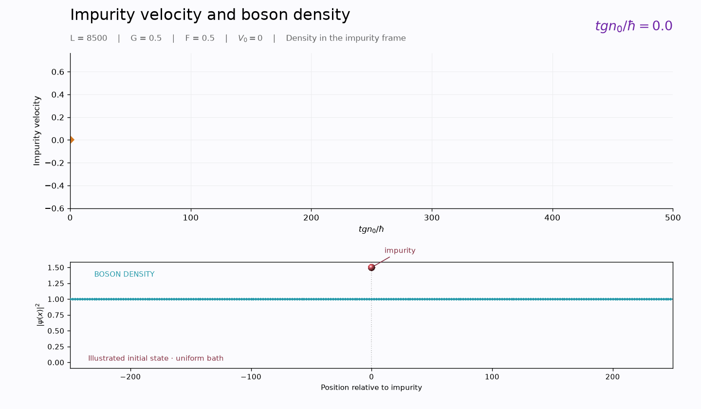
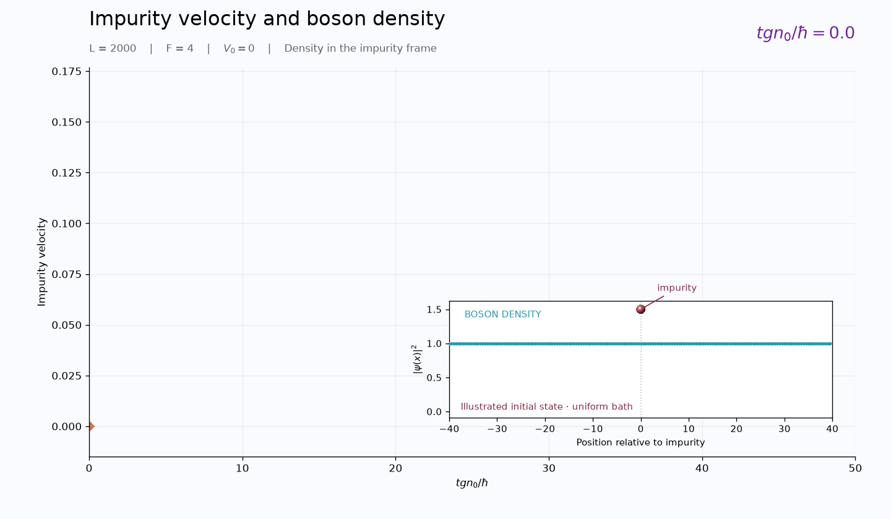

# GPE solver for a 1D Bose polaron

C++17 library with a Python interface for the coupled Gross–Pitaevskii equation
and impurity velocity,
with periodic boundaries, finite differences, and Picard iteration.
Use it for a fresh simulation or to continue from a compressed checkpoint.
All four solver interfaces stop on Picard nonconvergence; failed steps are not accepted.


- [Python installation](#python-installation-from-this-checkout)
- [Constant momentum (Quenched) impurity](#1-constant-momentum-quenched-impurity)
- [Constant force (Driven) impurity](#2-constant-force-driven-impurity)

## Python installation from this checkout

Python users call the same compiled C++ solver using `bose_polaron_gpe`.
NumPy arrays represent fields; all evolution and checkpoint I/O remain in C++.
**Use a checkout containing `pyproject.toml` and `environment-python.yml`: the
Python interface is not in the v0.3.1 archives below and is not yet on PyPI.**

From this repository's root, create a dedicated environment and install:

```sh
conda env create -f environment-python.yml
conda activate bose-polaron-gpe-python
python -m pip install --no-build-isolation --no-deps .
python -c "import bose_polaron_gpe as gpe; print(gpe.__version__)"
```

The environment supplies Python, NumPy, pybind11, scikit-build-core, the C++
compiler and native dependencies. Environment creation downloads packages;
installation compiles the extension using those existing dependencies.
`--no-build-isolation --no-deps` avoids downloading another set of dependencies.
Python users do not need to run the separate CMake commands below.
For Jupyter, select a kernel using this environment's Python.

| Python parameters | Fresh run / field in memory | Compressed continuation |
| --- | --- | --- |
| `gpe.SimulationParameters` (`V_0`) | `gpe.GPE_solver` | `gpe.GPE_solver_contd` |
| `gpe.DrivenSimulationParameters` (`F`) | `gpe.GPE_solver_driven` | `gpe.GPE_solver_driven_contd` |

Runnable Python snippets appear in each physical case below. To run the complete
example and Python tests in the activated environment:

```sh
python examples/python/simulation.py
python tests/python_api.py
```

The example creates `python-example-results/`, which must not already exist;
the tests use temporary directories. Every simulation requires a new output
directory with an existing parent. The small examples verify functionality;
they are not converged research simulations.

Results expose `final_time`, `final_velocity`, `final_field`, `velocity_file`,
and `configurations_archive`. `final_field` is a read-only NumPy `complex128`
array; use `.copy()` for a writable independent array. Assigning an initial
NumPy field to `parameters.initial_field` copies it; assign `None` to clear it.
Output paths accept strings or `pathlib.Path` and returned paths are
`pathlib.Path` objects. Velocity/configuration histories stream to disk.

Invalid settings, checkpoint errors and Picard nonconvergence raise Python
exceptions (`RuntimeError` for solver failures). A failed step is not accepted
or saved. Catch `RuntimeError` in your Python program to handle that stop.

See the [full Python guide](docs/PYTHON.md) for ownership, threads, source-build
requirements and wheel limitations, and the
[complete example](examples/python/simulation.py) for all four calls.

## Shared setup

The following download and build commands are for C++ users in both cases.
Python users should follow the installation above. Release v0.3.1 includes
both quenched and driven C++ impurity solvers.

### Download

Download **one complete source archive** from release **v0.3.1**:

- **[Download .tar.gz (Linux/macOS)](https://github.com/saptarshi7889/Conservative-Finite-Difference-Method-for-GPE-of-1d-Bose-Polaron/releases/download/v0.3.1/bose-polaron-gpe-0.3.1.tar.gz)**
- **[Download .zip](https://github.com/saptarshi7889/Conservative-Finite-Difference-Method-for-GPE-of-1d-Bose-Polaron/releases/download/v0.3.1/bose-polaron-gpe-0.3.1.zip)**
- [Release notes and checksums](https://github.com/saptarshi7889/Conservative-Finite-Difference-Method-for-GPE-of-1d-Bose-Polaron/releases/tag/v0.3.1)

Both archives contain the same source code. Download the complete archive:
these headers belong to a **compiled library** and require the implementation
in `src/`. The download contains source, not precompiled executables.

### Build and run

Requirements: a C++17 compiler, Eigen 3.3+, zlib, libarchive with gzip/XZ support,
CMake 3.17+, and Python 3 for the tests. The supplied Conda environment keeps
these dependencies separate from your base environment.

For the `.tar.gz` download:

```sh
tar -xzf bose-polaron-gpe-0.3.1.tar.gz
cd bose-polaron-gpe-0.3.1
conda env create -f environment.yml
conda activate bose-polaron-gpe
cmake -S . -B build -DCMAKE_BUILD_TYPE=Release
cmake --build build --parallel 2
ctest --test-dir build --output-on-failure
./build/gpe --output results
```

For `.zip`, extract it and enter `bose-polaron-gpe-0.3.1`, then follow the same
commands starting at `conda env create`. If you already have the dependencies,
start at `cmake -S .`. Environment creation downloads packages; build commands
use existing dependencies.

The last command runs a small demonstration from a uniform field to `t=0.02`.
Its defaults are L=16, dx=0.125, dt=0.001, V0=2, m/M=0.125, G=-1.5,
and gamma=0.1. It is a functionality check, not a converged research simulation.
Each run needs a **new output directory**. List options with `./build/gpe --help`.

## 1. Constant momentum (Quenched) impurity

With no external force, the total momentum is fixed by the initial quench.
Set the injection velocity through `SimulationParameters::V_0` and leave
`force = 0` (the default). The impurity velocity evolves through its coupling
to the Bose gas.

### Run from Python

After installing the Python package above, run this in Python or a notebook:

```python
import numpy as np
import bose_polaron_gpe as gpe

parameters = gpe.SimulationParameters()
parameters.V_0 = 0.5
parameters.G = -1.5
parameters.length = 16.0
parameters.dx = 0.125
parameters.dt = 0.001
parameters.t_final = 0.02
parameters.output_directory = "quenched-python-results"
result = gpe.GPE_solver(parameters)

density = np.abs(result.final_field) ** 2
print(result.final_time, result.final_velocity)
print(result.velocity_file, result.configurations_archive)
```

Continue that run from its compressed t=0.02 checkpoint in the same Python
session, keeping the original `V_0` and physical/grid parameters:

```python
parameters.t_initial = result.final_time
parameters.t_final = 0.04
parameters.initial_velocity = result.final_velocity
parameters.initial_field = None
parameters.output_directory = "quenched-python-continued"
continued = gpe.GPE_solver_contd(
    parameters, result.configurations_archive, "phi_20.dat"
)
```

For a field already in memory, assign `parameters.initial_field = result.final_field`
and call `gpe.GPE_solver(parameters)` instead, with the checkpoint time and
velocity set as above and a new output directory.

### Run your own C++ simulation

Choose the public header for your starting state:

| Task | Header | Function |
| --- | --- | --- |
| Fresh run or supplied field in memory | `gpe/solver.hpp` | `gpe::GPE_solver` |
| Continue from a compressed checkpoint on disk | `gpe/GPE_solver_contd.hpp` | `gpe::GPE_solver_contd` |

The complete program in **[examples/library/main.cpp](examples/library/main.cpp)**
first runs a fresh simulation, then continues it directly from its compressed
archive. Build and run it from the repository root after building the library:

```sh
cmake --install build --prefix "$PWD/build/install"
cmake -S examples/library -B build/example -DCMAKE_PREFIX_PATH="$PWD/build/install"
cmake --build build/example --parallel 2
cmake -E chdir build/example ./simulation
```

Its outputs are `build/example/library-results/` and
`build/example/continued-library-results/`. Edit `gpe::SimulationParameters`
in the example to set your physical parameters, grid, time interval, save
intervals, and output directory. See the [full parameter guide](docs/USAGE.md#c-library).

In your own CMake project, use the installed package:

```cmake
cmake_minimum_required(VERSION 3.17)
project(my_simulation LANGUAGES CXX)
find_package(gpe CONFIG REQUIRED)
add_executable(simulation main.cpp)
target_link_libraries(simulation PRIVATE gpe::solver)
```

Pass the library installation directory through `-DCMAKE_PREFIX_PATH` as above.

### Continue from a compressed checkpoint

Include **`<gpe/GPE_solver_contd.hpp>`** and retain the physical/grid parameters
of the original run. Set the checkpoint time and the velocity recorded at that
time; `V_0` remains the original injection velocity.

Inside your simulation program, with those values supplied:

```cpp
// parameters contains the same physical and numerical settings as the original run.
parameters.t_initial = checkpoint_time;       // Must be greater than zero.
parameters.t_final = next_final_time;
parameters.initial_velocity = checkpoint_velocity;
parameters.initial_field.resize(0);          // Load the field from the file below.
parameters.output_directory = "continued-results";
const std::filesystem::path checkpoint_file = "/path/to/previous-run/configurations.tar.gz";

// Select the snapshot matching checkpoint_time inside the archive.
auto continued = gpe::GPE_solver_contd(parameters, checkpoint_file, "phi_20.dat");
```

In the small example above, `phi_20.dat` is the checkpoint at `t=0.02`.
For a single compressed field, omit the archive member argument:

```cpp
const std::filesystem::path checkpoint_file = "/path/to/phi_20.dat.xz";
auto continued = gpe::GPE_solver_contd(parameters, checkpoint_file);
```

Supported inputs: `.dat.gz`, `.dat.xz`, `.tar.gz`, and `.tar.xz`.
The reader streams decompressed text through a 64 KiB buffer into the field
vector, without creating an expanded file. Memory also includes the decoder
buffers and the solver's working vectors.

Keep `length`, `dx`, `dt`, `mass_ratio`, `G`, `gamma`, and `V_0` consistent with
the checkpoint. The field file has no time/parameter metadata, so the caller
supplies the matching time and checkpoint velocity. Output times start at
`t_initial`; configuration step names start at zero for the new segment.
See the [continuation guide](docs/USAGE.md#continue-directly-from-a-compressed-checkpoint).

### Impurity velocity and density evolution

Impurity velocity with a synchronized boson-density inset in the impurity frame.


[Download the video](docs/media/velocity_density_animation.mp4)

### Validation

The original and packaged implementations matched all 251 saved velocities
through t=25 in the L=500, V0=0.5 comparison. Both continuation implementations
also matched all 51 saved velocities from t=20 to t=25. These checks establish
implementation agreement for those runs. Conservation and grid/time convergence
must be checked for each scientific study; see [VALIDATION.md](VALIDATION.md).

### Related paper

Saptarshi Majumdar and Aleksandra Petković, “Relaxation dynamics of a mobile
impurity injected into a one-dimensional Bose gas,” Physical Review A **112**,
053326 (2025), [doi:10.1103/tgl5-rdn5](https://doi.org/10.1103/tgl5-rdn5).

## 2. Constant force (Driven) impurity

A constant external force F drives the impurity through the Bose gas. The two
original adiabatic research programs are retained in `legacy/`:

- [Fresh driven run](legacy/finite_difference_modified_impurity_Thomas_generalized_adiabatic_without_Matrix_hermitian_vel_massdep_Kamenev_new_cluster_upwind_scheme.cpp).
- [Driven continuation](legacy/finite_difference_modified_impurity_Thomas_generalized_adiabatic_without_Matrix_hermitian_vel_contd_massdep_Kamenev_new_cluster_upwind_scheme.cpp).

For reusable driven simulations, use the headers below with
`DrivenSimulationParameters::F`. The CLI accepts `--force F --velocity 0`.
The driven interfaces fix V₀ = 0 and use drive velocity `(m/M)*F*t`,
with the boson momentum contribution added to obtain the impurity velocity.

| Task | Header | Function |
| --- | --- | --- |
| Fresh driven run / field in memory | `gpe/GPE_solver_driven.hpp` | `gpe::GPE_solver_driven` |
| Driven compressed continuation | `gpe/GPE_solver_driven_contd.hpp` | `gpe::GPE_solver_driven_contd` |

Set `gpe::DrivenSimulationParameters`: the simulation settings match
`SimulationParameters`, with `F` replacing `V_0` and no separate `force` field.
Link to the same `gpe::solver` compiled library. The default initial field is uniform.

The v0.3.1 source archives above include both driven headers, their compiled
implementation, and the runnable example.

[Runnable driven example and research-code instructions](examples/driven/README.md)
cover a fresh run and continuation directly from its compressed checkpoint.
Keep F and all physical/grid settings when restarting;
the force uses absolute simulation time, not time since restart.

### Run from Python

Use `DrivenSimulationParameters` with `F` replacing `V_0`:

```python
import numpy as np
import bose_polaron_gpe as gpe

parameters = gpe.DrivenSimulationParameters()
parameters.F = 0.5
parameters.G = 0.5
parameters.mass_ratio = 1.0 / 3.0
parameters.gamma = 1.0 / 400.0
parameters.length = 16.0
parameters.dx = 0.125
parameters.dt = 0.001
parameters.t_final = 0.02
parameters.output_directory = "driven-python-results"
result = gpe.GPE_solver_driven(parameters)

density = np.abs(result.final_field) ** 2
print(result.final_time, result.final_velocity)
```

Continue from that run's compressed checkpoint without resetting the force clock:

```python
parameters.t_initial = result.final_time
parameters.t_final = 0.04
parameters.initial_velocity = result.final_velocity
parameters.initial_field = None
parameters.output_directory = "driven-python-continued"
continued = gpe.GPE_solver_driven_contd(
    parameters, result.configurations_archive, "phi_20.dat"
)
```

Retain F and the physical/grid settings. For continuation in memory, assign
`parameters.initial_field = result.final_field` and call
`gpe.GPE_solver_driven(parameters)` with the same checkpoint time and velocity,
and a new output directory. In either physical case, `phi_20.dat` is specific
to these examples; select the matching member for your own checkpoint. For a
single `.dat.gz` or `.dat.xz` field, omit the member argument.

### Build and run the driven example

After building the current source with the shared setup commands:

```sh
cmake --install build --prefix "$PWD/build/install"
cmake -S examples/driven -B build/driven -DCMAKE_PREFIX_PATH="$PWD/build/install"
cmake --build build/driven --parallel 2
cmake -E chdir build/driven ./simulation
```

The example uses F=0.5, G=0.5, gamma=1/400 and M=3m on a small test grid.
Edit `gpe::DrivenSimulationParameters` in
[examples/driven/main.cpp](examples/driven/main.cpp) for your settings.

### Continue from a compressed checkpoint

Include `<gpe/GPE_solver_driven_contd.hpp>`, retain F and the physical/grid
settings, and supply the absolute checkpoint time and recorded velocity:

```cpp
// parameters is a DrivenSimulationParameters with matching run settings.
parameters.t_initial = checkpoint_time;
parameters.t_final = next_final_time;
parameters.initial_velocity = checkpoint_velocity;
parameters.initial_field.resize(0);
parameters.output_directory = "continued-driven-results";
auto continued = gpe::GPE_solver_driven_contd(
    parameters, checkpoint_file, "phi_20.dat");
```

Use the member matching your checkpoint; `phi_20.dat` is the t=0.02 checkpoint
in the small example. Compressed formats and streaming behavior are the same
as in the quenched case. The force clock continues from `t_initial`.

### Driven impurity: generalized case

G = 0.5, F = 0.5, gamma = 1/400, M = 3m (L = 8500).



[Watch/download MP4](docs/media/G05_F05_L8500/velocity_density_animation.mp4) ·
[Animation provenance and rendering](examples/G05_F05_L8500/README.md)

### Very strongly coupled impurity

G = 15, F = 4, gamma = 1/400, M = 3m.



[Watch/download MP4](docs/media/F4/velocity_density_animation.mp4) ·
[Animation provenance and rendering](examples/F4/README.md)

Both animations show recorded velocity and density in the impurity frame.
Their immersion openings and transitions to the first saved field are
illustrative, as described in the example READMEs. These are supplied research
runs; the small library example does not reproduce their full grids or duration.

### Related papers

The constant-force dynamics are discussed in:

- Saptarshi Majumdar and Aleksandra Petković, “Bloch oscillations of a mobile impurity in a one-dimensional Bose gas,” Physical Review A **113**, 043309 (2026), [doi:10.1103/bfcg-m2tw](https://journals.aps.org/pra/abstract/10.1103/bfcg-m2tw) (repulsive interaction).
- Saptarshi Majumdar and Aleksandra Petković, “Driven dynamics of an attractive Bose polaron,” Physical Review A **114**, 053303 (2026), [doi:10.1103/t36j-gd59](https://journals.aps.org/pra/abstract/10.1103/t36j-gd59) (attractive interaction).

## Output files

| File | Contents |
| --- | --- |
| `velocity.dat` | Time, real velocity, imaginary velocity |
| `configurations.tar.gz` | Compressed `phi_STEP.dat` fields: x, Re(phi), Im(phi) |
| `parameters.txt` | Parameters and restart provenance |
| `norm.dat` | Field norm and particle-number diagnostic |
| `convergence.dat` | Picard iterations and last iterate difference |

Velocity and configuration save intervals count **time steps**, not Picard
iterations. Initial and final states are always saved. The command-line driver
also writes plain `phi_STEP.dat` snapshots.

## Repository guide

| Location | Purpose |
| --- | --- |
| `python/` | Python package and pybind11 bindings to the C++ solver |
| `examples/python/` | Python quenched/driven and compressed-continuation example |
| `include/gpe/` | Public headers for your programs |
| `src/` | Compiled solver implementation and command-line driver |
| `examples/library/` | Quenched fresh-run and compressed-continuation example |
| `examples/driven/` | Driven fresh-run and compressed-continuation example |
| `examples/L500_v05/` | Advanced comparison and research reproduction scripts |
| `tests/` | Numerical, restart, archive, and interface tests |
| `legacy/` | Original research programs, preserved for reference |
| `docs/` | Detailed usage, equations, numerical method, and demo media |

[Detailed build/API guide](docs/USAGE.md) ·
[Equations and numerical method](docs/NUMERICS.md) ·
[Validation and limitations](VALIDATION.md) ·
[Release notes](RELEASE_NOTES.md) · [Maintainer publishing guide](PUBLISHING.md)

[Project website source](docs/index.html) · [GitHub Pages setup](docs/PAGES.md)

## License

MIT license; see [LICENSE](LICENSE) and [CITATION.cff](CITATION.cff).
