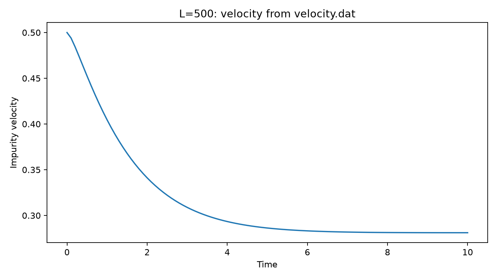
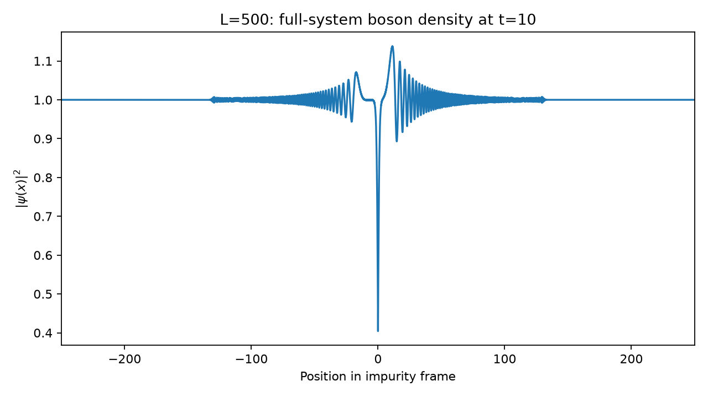

# L=500 run, stop at t=10

Local output: `results_L500_v05/`, excluded from Git.
The simulation runs only to t=10; no continuation is launched.

Parameters: L=500, dx=0.001, dt=0.01, V0=0.5, m/M=0.333,
G=1, gamma=0.1, Picard limit=10, absolute tolerance=1e-8.
Initial field: psi=1. Velocity is saved and flushed every 10 steps;
configurations and norm are saved every 50 steps, including initial/final states.

Completed configurations are published by atomic rename. One worker compresses
with XZ -9e and SHA-256, tests each archive, then removes its raw source.
The runner prevents simultaneous launches and refuses existing output.
Compression failures preserve raw files. Existing dependencies are reused.

This folder was restored after accidental deletion while the simulation was
paused. Data in `results_L500_v05/` were retained; the existing process resumes.
The original solver.log was unlinked by the deletion; velocity, norm, convergence,
and parameter files remain available in the output directory.

At completion, the plotting script reads velocity.dat and the t=10 checkpoint.
See summary.txt for convergence and norm-drift diagnostics. A single run does
not establish elimination of boundary effects or spatial/temporal convergence.

## Continuation from t=10 to t=20

`continue_run.py` resumes `results_L500_v05/phi_1000.dat.xz` using its
logged checkpoint velocity (0.2811383215428751), with V0=0.5 unchanged.
It appends directly to the existing **velocity.dat**; there is no separate
vel.dat file. Norm and convergence histories are appended too. The original
parameters.txt is preserved and continuation metadata is stored separately.
Configurations phi_1050.dat.xz through phi_2000.dat.xz use absolute step numbers
and remain in the same results directory. Save intervals and compression are
unchanged. A temporary decompressed restart file is removed after loading.

The executable is compiled from the numerical routines and time-update block of
`finite_difference_modified_impurity_Thomas_generalized_without_Matrix_hermitian_vel_contd_new_cluster_upwind_scheme.cpp`,
using `prepare_continuation.py` to add the validated restart/output driver from
src/main.cpp. The original research file is unchanged. The generated driver
checks convergence, stops exactly at t=20, flushes velocities, appends without
a duplicate t=10 row, and publishes only completed configuration files.
Small positive/negative-velocity split-run checks agree with continuous evolution
within 2e-13; existing CLI checks pass with absolute continuation step filenames.

At t=15, plot_t15.py generates velocity_t15.png from velocity.dat, density_t15.png
for -20<x<20, and density_t15_full_system.png, while evolution continues to t=20.
Monitor results_L500_v05/velocity.dat and continuation.log. Completion checks
verify the original velocity bytes are intact, 201 velocity records, and 41
compressed configurations. No continuation beyond t=20 is launched.

## Restart from the saved t=16.5 checkpoint

The paused solver was retired so the next evolution starts exactly from
phi_1650.dat.xz with checkpoint velocity 0.2815169869407339. V0 remains 0.5.
All physical and numerical parameters, save intervals, append behavior,
and the continuation-source executable remain unchanged. Existing t=15 plots
are preserved. New configurations use absolute steps 1700 through 2000 in the
same results folder. The new solver log is continuation_1650.log.
The endpoint is t=20; no evolution beyond t=20 is launched.

## Continuation from t=20 to t=25

Restart: phi_2000.dat.xz with logged velocity 0.2817480339881665.
All physical/numerical parameters and the continuation-source executable remain
unchanged. The runner appends velocity/norm/convergence records to the same
files and saves steps 2050 through 2500 in the same results directory.
Configurations are compressed and verified, then raw files are removed.
No duplicate t=20 velocity row is written. Existing history is checked for
byte-for-byte preservation at completion. Expected totals: 251 velocity rows
and 51 compressed configurations. The endpoint is t=25, with no later evolution.

At t=25, plot_t25.py generates velocity_t25.png, density_t25.png (-15<x<15),
and density_t25_full_system.png. Log: continuation_2000.log; completion report:
continuation_2000_summary.txt. Earlier plots and reports are preserved.

## Synchronized velocity and density animation

`animate.py` reads all 51 compressed configurations (t=0,0.5,...,25) and
velocity.dat. The velocity history is the main plot; a synchronized density
inset shows -15<x<15 in the impurity frame. Both axes remain fixed.
No saved time slices are skipped; original data stay compressed and unchanged.

Outputs: velocity_density_animation.mp4 (H.264, 1440x840),
velocity_density_animation.gif, and velocity_density_animation_preview.png.
Playback: 5 frames/s, duration 10.2 s. Each frame advances 0.5 simulation time
units, corresponding to 2.5 simulation time units per playback second.
animation_manifest.json records all source configurations and frame times.
Existing GStreamer, NumPy, Matplotlib, and Pillow installations were reused.
The MP4 stream was inspected and decoded successfully; the GIF has 51 frames.

Regenerate: `MPLCONFIGDIR=/tmp/gpe-L500-mpl python3 examples/L500_v05/animate.py`.
