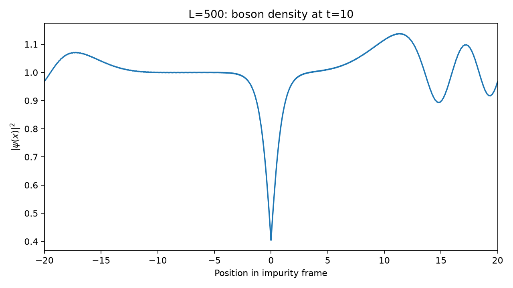

# L=500 run, stop at t=10

Local output: `results_L500_v05/`, excluded from Git.
The simulation runs only to t=10; no continuation is launched.

Parameters: L=500, dx=0.001, dt=0.01, V0=0.5, m/M=0.333,
G=1, gamma=0.1, Picard limit=10, absolute tolerance=1e-8.
Initial field: psi=1. Velocity is saved and flushed every 10 steps;
configurations and norm are saved every 50 steps, including initial/final states.

Completed configurations are published by atomic rename. One worker compresses
with XZ -9e and SHA-256, tests each archive, then removes its raw source.
The runner prevents simultaneous launches and refuses existing output.
Compression failures preserve raw files. Existing dependencies are reused.

This folder was restored after accidental deletion while the simulation was
paused. Data in `results_L500_v05/` were retained; the existing process resumes.
The original solver.log was unlinked by the deletion; velocity, norm, convergence,
and parameter files remain available in the output directory.

At completion, the plotting script reads velocity.dat and the t=10 checkpoint.
See summary.txt for convergence and norm-drift diagnostics. A single run does
not establish elimination of boundary effects or spatial/temporal convergence.

## Continuation from t=10 to t=20

`continue_run.py` resumes `results_L500_v05/phi_1000.dat.xz` using its
logged checkpoint velocity (0.2811383215428751), with V0=0.5 unchanged.
It appends directly to the existing **velocity.dat**; there is no separate
vel.dat file. Norm and convergence histories are appended too. The original
parameters.txt is preserved and continuation metadata is stored separately.
Configurations phi_1050.dat.xz through phi_2000.dat.xz use absolute step numbers
and remain in the same results directory. Save intervals and compression are
unchanged. A temporary decompressed restart file is removed after loading.

The executable is compiled from the numerical routines and time-update block of
`finite_difference_modified_impurity_Thomas_generalized_without_Matrix_hermitian_vel_contd_new_cluster_upwind_scheme.cpp`,
using `prepare_continuation.py` to add the validated restart/output driver from
src/main.cpp. The original research file is unchanged. The generated driver
checks convergence, stops exactly at t=20, flushes velocities, appends without
a duplicate t=10 row, and publishes only completed configuration files.
Small positive/negative-velocity split-run checks agree with continuous evolution
within 2e-13; existing CLI checks pass with absolute continuation step filenames.

At t=15, plot_t15.py generates velocity_t15.png from velocity.dat, density_t15.png
for -20<x<20, and density_t15_full_system.png, while evolution continues to t=20.
Monitor results_L500_v05/velocity.dat and continuation.log. Completion checks
verify the original velocity bytes are intact, 201 velocity records, and 41
compressed configurations. No continuation beyond t=20 is launched.
